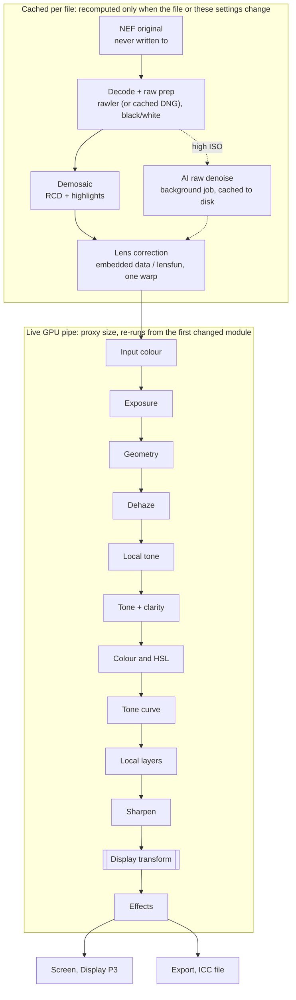
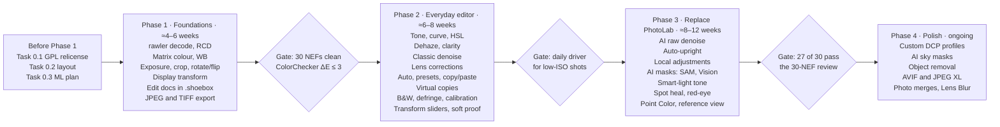

# Shoebox — Photo Editing Spec

Status: draft, last updated 19 October 2026. This is the source of truth for the Develop (editing) work, alongside `docs/SPEC.md` (the library) and `docs/DECISIONS.md` (where the code deliberately differs, with measurements). Flag any conflict between them rather than silently diverging. Start with *Before Phase 1: repository changes*; Task 0.1 must land before anything else.

## Goals and non-goals

Shoebox gains a Develop view that turns Nikon NEF files into finished images good enough that DxO PhotoLab is no longer needed. It is built as a Rust crate (`shoebox-develop`) that the existing library app calls into, rendering on the GPU through the wgpu device egui already owns.

**Who it's for.** One photographer shooting a Nikon Z f in NEF + JPEG. Shoebox is a personal tool first. The code is public on GitHub for others to use, and it will never be sold. Shoebox is moving to GPL-3.0-or-later (Task 0.1), so the spec draws on darktable, RawTherapee and LightCraft alike.

**Starting point: PhotoLab's auto mode.** Most photos today get PhotoLab's default automatic corrections and little else. Shoebox's Auto rendering therefore matters more than any single slider (see Auto mode, presets and packs). Presets and preset packs come next, and the rest of PhotoLab's feature set stays in scope as options.

**Goals**

- Non-destructive editing of NEF, TIFF and JPG from the existing dated archive; originals are never written to.
- An Auto rendering on first open that looks finished with no manual edits.
- Real-time slider feedback on a MacBook Pro M2 Max (32 GB) for global adjustments.
- Feature parity with PhotoLab: RAW colour, exposure and tone, white balance, AI denoise (DeepPRIME equivalent), lens corrections, dehaze (ClearView equivalent), local tone mapping (Smart Lighting equivalent), perspective (ViewPoint equivalent), local adjustments, crop and export. FilmPack-style looks, U Point-style control points and ViewPoint's volume fix follow as Phase 4 options.
- Presets and preset packs, including film-look LUTs and imported Lightroom presets.
- Batch workflow: copy/paste settings, sync across a selection, virtual copies.
- The standard tools Lightroom Classic and darktable share beyond PhotoLab's set (see Tools beyond PhotoLab), plus photo merges and Lens Blur in Phase 4.
- Every still image is editable (NEF, DNG, JPEG, TIFF, PNG, HEIC), not only raw files.
- Edits stored so they survive the app, the catalog, or a move to another machine.

**Non-goals (v1)**

- Layers, compositing, generative fill or anything Photoshop-shaped.
- AI Super Resolution (upscaling), and darktable's niche modules: liquify, tone equalizer, film-negative inversion, enlarge canvas.
- Print module, tethered shooting, video.
- Reading DxO `.dop` files, or round-tripping edits with Lightroom. Importing Lightroom *presets* is in scope. Ratings, labels and keywords still go through standard XMP.
- Cameras other than the Nikon Z f and any older Nikon bodies in the archive. The decoder supports others, but they are not tested targets.

**Definition of done:** pick 30 representative NEFs (low light, high ISO, backlit, landscape with sky, portrait, architecture) and review them at 100% and at fit-to-screen, in two passes. Pass 1 judges Shoebox's Auto rendering with no manual edits; Pass 2 judges each photo edited normally. The camera's own JPEG of each frame is the only outside reference. Shoebox must be acceptable on at least 27 of 30 in each pass.

**Testing never depends on other editors.** No review, gate or benchmark needs DxO PhotoLab, DeepPRIME, PureRAW, Lightroom or any other licensed tool. Photos are judged on their own merits, against the camera JPEG, and by measurement (ColorChecker ΔE, golden images). Other editors appear in this spec only to name features to build.

## Reference implementation: LightCraft

[LightCraft](https://github.com/storytold/lightcraft) is a pure-Rust, egui and wgpu, MIT/Apache-2.0 raw editor built on the same design as this spec. Shoebox uses it only as a reference: study how a module is done there, then write Shoebox's own version. Nothing from it goes in `Cargo.toml`.

**Rules for using it as a guide**

- Record the commit SHA you studied at the top of each Shoebox module that follows it, because the project moves fast.
- Brief Claude Code with: "Read LightCraft `crates/<name>` for the approach; do not add it as a dependency; implement in `shoebox-develop`."
- If a function or shader is ported closely rather than re-derived, keep LightCraft's MIT licence text in `THIRD_PARTY.md` with the source file path. MIT asks for nothing more.
- LightCraft's clean-room rule (never read GPL sources) does not bind Shoebox. As a GPL-3.0 project, Shoebox can study and port from darktable and RawTherapee as well. Keep the habit of noting where each algorithm came from.

**Where to look for each part of this spec**

| Spec area | Study in LightCraft | What to take from it |
| --- | --- | --- |
| RAW decode | `crates/raw` | Pure-Rust NEF decoding (uncompressed, lossless and lossy compressed) and Nikon Z distortion data, including the Z f's. Compare against `rawler` on your own files before choosing |
| Colour | `crates/color` | Linear Rec.2020, Bradford-adapted white balance, gamut mapping instead of clipping, adjustments in OkLCh. Profiles estimated from camera JPEGs (built-in Z 6II and Z 8, no Z f yet): the method to follow for Camera match |
| ICC output | its use of the `moxcms` crate | Pure-Rust colour management; replaces `lcms2` (a C library) in this spec |
| Settings model | `crates/develop` | Each control defined with range, default and current value; compare with the edit document here |
| Pipeline and cache | `crates/pipeline`, `crates/gpu` | wgpu kernels checked against a CPU pipeline to within 1/255; re-runs only the stages a slider affects; draft renders while dragging |
| Tone, dehaze, clarity | `crates/develop`, `crates/pipeline` | Guided filter on log-luminance for highlights and shadows; dark-channel dehaze with guided refinement; monotone tone curves |
| Masks and local adjustments | search `mask` in `develop` and `pipeline` | Brush, linear, radial, luminance and colour range; add, subtract, intersect; 15 adjustments per mask; radii relative to image size |
| Geometry and Upright | `crates/geom` | Auto, Level, Vertical, Full and Guided Upright; straightening that keeps the largest crop inside the frame |
| Previews | `crates/preview` | Embedded JPEG shown in about 0.1 s; next and previous photos prepared in the background |
| History | `crates/catalog` | Append-only operation log; one slider drag is one undo step |
| XMP | `crates/meta` | Sidecar read/write, plus reading Lightroom `crs:` develop settings from old edits |
| Export | `crates/codecs` | Encoders, output sharpening, batch export that overlaps decode, render and encode |
| Working with Claude Code | `AGENTS.md`, `CLAUDE.md` | Never-crash rules (no `unwrap`, checked indexing) and green CI before every commit |
| Feature checklist | `docs/parity-checklist.md`, `docs/gaps.md`, `docs/raw-parity.md` | Lightroom parity tracked row by row; raw-parity shows support for your Nikon body |

**What it shows about performance:** on a 24 MP raw on an M4 Pro, a slider update re-renders in about 4 ms and a full-size export takes about 0.3 s. The targets in Performance are conservative by comparison; tighten them after the Phase 1 benchmarks.

**Where it won't help yet:** AI denoise is in progress, AI subject and sky masks are classical heuristics, Nikon HE NEFs are not decoded, and it has no lens-profile database. For those, this spec's own plans (RawNIND, SAM and Apple Vision, Lensfun) stand. Source: [LightCraft README](https://github.com/storytold/lightcraft).

## Before Phase 1: repository changes

Three changes to the existing repo (`PinkOctopusLabs/shoebox`, public) come before any editing code. The licence change must land first: no darktable, RawTherapee or RawNIND material may enter the repo while it is MIT/Apache.

**Task 0.1: Relicense to GPL-3.0-or-later**

The public repo counts as distribution, and GPL code can't be offered under MIT/Apache, so the switch has to come before any port. Releases already published stay MIT/Apache for whoever took them, and that is fine. The maintainer is the only contributor, so no one else's consent is needed. Brief for Claude Code:

1. `Cargo.toml`: under `[workspace.package]`, set `license = "GPL-3.0-or-later"`. Every crate already uses `license.workspace = true`, so nothing else changes there. Leave `vendor/candle-metal-kernels` under its own licence.
2. Add `LICENSE` with the verbatim FSF GPL-3.0 text (674 lines, SHA-256 `3972dc9744f6499f0f9b2dbf76696f2ae7ad8af9b23dde66d6af86c9dfb36986`). Remove `LICENSE-MIT` and `LICENSE-APACHE`. The `rm` needs the maintainer's go-ahead.
3. `README.md`, Licence section: replace the dual-licence line with "Licensed under the GNU General Public License v3.0 or later; see LICENSE." Keep the third-party credits beneath it as they are (Sparkle, Phosphor, SigLIP 2, YuNet, SFace and candle are all MIT or Apache-2.0, which are compatible with GPL-3.0).
4. `scripts/bundle-macos.sh`: copy `LICENSE` to `Contents/Resources/LICENSE.txt` next to the Phosphor and Sparkle licences. GPL binaries must ship with the licence text, and the public repo plus GitHub Releases satisfy the requirement to make source available.
5. `docs/DECISIONS.md`: add an entry at the end in the current style, "Licence: GPL-3.0-or-later (date)": why (to port GPL raw-processing code and ship the GPL RawNIND models), that versions up to 0.2.3 were MIT OR Apache-2.0, and that Shoebox will not be sold.
6. `CLAUDE.md`, Working rules: add "Licence is GPL-3.0-or-later. Code ported from darktable, RawTherapee or other GPL projects is allowed; note the source file and commit in a comment at the top of the module. Never add a dependency whose licence is incompatible with GPL-3.0 (for example, proprietary or GPL-2.0-only)."
7. Run `cargo fmt`, `cargo clippy --all-targets -- -D warnings` and `cargo test`. Commit as its own change, separate from feature work.

**Task 0.2: Know the current preview path**

Shoebox shows NEFs today without decoding raw data. `shoebox-decode/src/nef.rs` walks the NEF's TIFF IFDs for embedded JPEGs, and `render()` in `shoebox-decode/src/lib.rs` decodes the smallest one big enough (full-size `JpgFromRaw` in the loupe) with `zune-jpeg`, converts it with `moxcms`, and orients it. Stacks put the NEF in front of its JPEG. That path reads High efficiency NEFs fine and stays: it is Develop's instant first paint and the library's thumbnail source. The raw decoder goes beside it in `shoebox-decode` (a new `raw` module), and the edit pipeline in a new `shoebox-develop` crate that `shoebox-app` calls. Record that layout in `CLAUDE.md`'s Layout section.

**Task 0.3: ML models from their original sources, on candle (decided)**

Every model runs on `candle`, which `shoebox-ml` already uses. Each is implemented natively in Rust, the way SigLIP 2 is, with weights from the original authors rather than darktable-ai's ONNX packages. [darktable-ai](https://github.com/darktable-org/darktable-ai) (GPL-3.0) is the guide: each model's `README.md`, `model.yaml` and `convert.py` there record which checkpoint they chose, how to feed it, and the pitfalls. **Do not add `ort`** (`docs/DECISIONS.md`, M6, already rejected it), and don't grow `shoebox-ml::onnx` for these models. `shoebox-develop` depends on `shoebox-ml` for them.

| Model | Original source | Weights | In Shoebox | Phase |
| --- | --- | --- | --- | --- |
| RawNIND UtNet2, Bayer (joint denoise and demosaic) | Benoit Brummer, UCLouvain: [rawnind\_jddc](https://github.com/trougnouf/rawnind_jddc). Code GPL-3.0; weights GPL-3.0 + CC BY 4.0 | PyTorch checkpoints, only in the author's Google Drive folder (linked from the repo README) | Port `UtNet2` from `src/rawnind/models/raw_denoiser.py` to candle, about 120 lines: 3×3 convolutions with LeakyReLU, 2×2 max-pool, 2×2 stride-2 transposed convolutions, skip concatenation, and a 1×1 convolution plus PixelShuffle head. Weights converted once to safetensors (below) | 3 |
| SAM 2.1 Hiera, image predictor only | Meta: [sam2](https://github.com/facebookresearch/sam2), Apache-2.0 | [facebook/sam2.1-hiera-tiny](https://huggingface.co/facebook/sam2.1-hiera-tiny) on Hugging Face: `model.safetensors`, 156 MB, Apache-2.0 | Port the image path to candle: Hiera encoder, FPN neck, prompt encoder and mask decoder, none of the video memory modules. Use `candle-transformers`' `segment_anything` (SAM 1) as the template for the prompt encoder and decoder. Pinned Hugging Face download, as SigLIP is | 3 |
| Sky segmentation | SegFormer trained on ADE20K | Hugging Face; check the licence | `candle-transformers`' own `segformer` | 4 |
| Object removal | Decide in Phase 4 | LaMa needs FFT, which candle lacks | Choose a convolution-only inpainting model, or skip it | 4 |

**RawNIND: choosing the checkpoint**

The author's folder has two Bayer checkpoints worth testing:

- `DenoiserTrainingBayerToProfiledRGB_4ch_2024-02-21-bayer_ms-ssim_mgout_notrans_valeither_-4` works at the packed half resolution and doubles it with PixelShuffle. darktable ships this one, describing it as "about 4× faster, marginally lower quality". A 512×512 packed tile is about 48.5 G multiply-adds; ONNX Runtime ran one in 0.51 s on two slow cloud CPU threads, so a 24 MP Z f frame (about 35 tiles) should take a few seconds on the M2 Max.
- `DenoiserTrainingBayerToProfiledRGB_4ch_2024-03-11-bayer_ms-ssim_mgout_preupsample_notrans_valeither_-2` first upsamples the packed input to full resolution (bilinear), so it costs about 4× as much and keeps more detail.

Convert both and run both through the quality gate in Noise reduction (the 10 highest-ISO Z f frames, reviewed at 100%). Keep the better one if it fits the 30 s target; offer the other as a faster or finer option if it's worth it. The linear (3-channel) RawNIND model isn't needed: every Z f file is Bayer.

**RawNIND: converting and hosting the weights**

Google Drive can't be a download source for the app (quota pages, no stable direct links), so conversion is a one-time job the maintainer runs.

1. Download the chosen `.pt` files from the author's Drive folder in a browser.
2. `scripts/convert-rawnind.py` (a `uv` script, CPU PyTorch, with rawnind\_jddc as a pinned git dependency) loads each checkpoint into rawnind\_jddc's own `UtNet2` class. Checkpoints may be a pickled `nn.Module` or a state dict, possibly with a `module.` prefix; handle all three, as darktable-ai's `convert.py` does. It writes `model.safetensors` and a `config.json` holding the checkpoint name, variant, `funit` 32, LeakyReLU, the preupsample flag, the original file's SHA-256, the source URL and both licences.
3. The script also runs the PyTorch model on three fixed random inputs and saves the outputs, so an ignored candle test can check the port to within 1e-3.
4. Publish the safetensors and config as assets on a Shoebox GitHub release (`models-rawnind-1`), with the GPL-3.0 and CC BY 4.0 notices and a link to rawnind\_jddc. `shoebox-ml::download` pins that URL and SHA-256, as it does for SigLIP. Weights never go in git.

**RawNIND: how to feed it** (from darktable-ai's `models/rawdenoise-nind/README.md` and `demo.py`)

1. Normalise each channel from its black level to its white level and clip to 0–1. Don't apply white balance before the model.
2. Pack the CFA into a half-resolution 4-channel tensor \[R, G1, G2, B\]. The Z f is RGGB (rawler's camera file); for any other pattern, shift the crop by a pixel so it becomes RGGB.
3. Tile with mirror padding at the image edges and 32 px of overlap, blended. Sides must be multiples of 16. A native port doesn't need darktable's fixed 512 px tiles, so choose the tile size by benchmark.
4. The output is **camera RGB** at full resolution, at an arbitrary learned gain; it is not Rec.2020. Scale it to match the input's mean, then apply the camera matrix (camera → XYZ → Rec.2020). The colour matrix isn't inside the model.
5. Run in **f32**. darktable pins this model to the CPU under Core ML because its activations overflow FP16 on Apple's GPU and Neural Engine. In candle, f32 on Metal or the CPU is fine. Benchmark both and record the numbers in `docs/DECISIONS.md`.

**SAM 2.1**

- Pin a revision of `facebook/sam2.1-hiera-tiny` and the SHA-256 of its `model.safetensors` (fill both in when implementing). Try `sam2.1-hiera-small` if Tiny's masks are rough.
- Check the port against Meta's PyTorch `SAM2ImagePredictor` on a few images: a script saves reference masks for fixed clicks, and an ignored test requires IoU ≥ 0.98.

**If candle is too slow** (over 30 s a frame for RawNIND), the fallback is Core ML through `objc2-core-ml`, not `ort`. For the RawNIND Bayer model that only works if it can run in f32.

## Architecture overview

Every edit is a small settings document; the image is re-rendered from the untouched original through a fixed-order pipeline, and only the stages downstream of a changed setting re-run.

- **Three layers.** Decode runs on the CPU and is cached per file. The pipeline runs as wgpu compute shaders on the GPU, sharing the device eframe already creates. AI stages run on candle (Metal or CPU) through shoebox-ml (Task 0.3).
- **Scene-referred, linear.** All processing between demosaic and the display transform happens in linear Rec.2020, 32-bit float RGBA. Values above 1.0 are kept, never clipped, until the final tone mapper. This is what makes exposure and highlight recovery behave like a camera rather than a JPEG.
- **Fixed order.** Modules run in one order no matter which slider the user touches first, as in Lightroom. Users cannot reorder modules; that is darktable's biggest usability cost and not worth copying.
- **Stage cache.** Each stage's output is cached and keyed by a hash of its own settings plus everything upstream. Moving the saturation slider reuses the cached decode, demosaic, denoise and lens-correction buffers and re-runs only the cheap tail of the pipe.
- **Two render sizes.** The interactive render works on a proxy (the demosaiced image downscaled to about 2560 px on the long edge). The full-resolution render is used for 100% zoom (only the visible tiles) and for export.
- **Slow stages are jobs.** AI denoise and AI masks never run on the slider path. They run as background jobs, write their results to a disk cache, and the pipe picks them up when ready. A fast classic approximation shows in the meantime.
- **Colour management at the edge.** Linear Rec.2020 goes in; the display transform converts to the screen's space for viewing and to the chosen ICC space for export.



Dashed: background job, result cached to disk.

The top band runs once per file and is cached; the live pipe re-runs from whichever module changed, and the display transform (double border) is where scene-linear light becomes a viewable image.

## Edit document and storage

Each photo's edit is one versioned JSON document. The catalog holds it for speed, and a file in the library root's hidden `.shoebox` folder holds the durable copy, so edits survive a lost catalog or a move to a new machine.

```json
{
  "schema": 1,
  "process_version": 1,
  "source": { "path": "2026/2026-10/DSC_1234.NEF", "xxh3": "9f2c…", "camera": "NIKON Z …", "lens": "NIKKOR Z …" },
  "copy": { "id": "main", "name": "Master" },
  "modules": {
    "white_balance": { "mode": "as_shot", "temp": 5200, "tint": 4 },
    "exposure": { "enabled": true, "ev": 0.7 },
    "denoise_ai": { "enabled": true, "strength": 0.85, "model": "rawnind-utnet2-bayer@models-rawnind-1" },
    "lens": { "profile": "auto", "distortion": 1.0, "vignetting": 1.0, "ca": true }
  },
  "geometry": { "rotate": -0.8, "keystone_v": 0.12, "crop": [0.04, 0.02, 0.96, 0.97], "aspect": "3:2" },
  "locals": [
    { "id": "l1", "name": "Sky", "mask": { "op": "add", "parts": [{ "kind": "ai_sky" }, { "kind": "linear", "from": [0.5, 0.0], "to": [0.5, 0.45] }] },
      "adjust": { "exposure": -0.4, "dehaze": 20 } }
  ],
  "history": [ { "t": "2026-10-17T21:40:00+08:00", "label": "Exposure +0.7", "patch": [] } ],
  "snapshots": [ { "name": "Before sky", "history_index": 4 } ]
}
```

- **Modules store only what differs from defaults.** Defaults live in code, per process version, so a new module never breaks old edits.
- **Process version.** Any change to an algorithm that alters rendered output bumps `process_version`. Old edits keep rendering with the old behaviour until the user chooses "Update to current process", as Lightroom does. Keep the previous versions' shader code paths for this reason.
- **Durable copy in `.shoebox`.** Write each edit to `<root>/.shoebox/edits/<path relative to root>.json`, for example `.shoebox/edits/2026/2026-10/DSC_1234.NEF.json`, atomically (write to temp, then rename). This is the folder that already holds `collections.json`, `events.json` and `stacks.json`, so it obeys CLAUDE.md's safety rule 3 once that rule is widened from `.shoebox/*.json` to `.shoebox/**/*.json`. Ratings, labels and keywords stay in the standard XMP sidecar as today. Keeping edits out of XMP means DxO, NX Studio, digiKam or anything else that rewrites XMP can never clobber an edit, and nested masks don't have to fit RDF.
  - **Moves and renames** through Shoebox (import, organise, rename, duplicate clean-up) move the edit file in the same journaled batch as the photo, as `fileops` already does for the other `.shoebox` files.
  - **Moves made outside Shoebox** (in Finder) leave the edit behind. Every edit records the original's content hash (`source.xxh3`), so on rescan an edit whose photo has gone is reattached to the file with the same hash, the way semantic-search rows follow moved files. Edits that match nothing are kept and listed in Settings, never deleted.
  - **Reference roots** are read-only, so photos in them can't be edited; Develop opens them read-only and offers to import them.
- **Catalog.** SQLite table `edits(photo_id, copy_id, doc_json, doc_hash, updated_at)`. The catalog is the working copy; the .shoebox file is written on a 2-second debounce and on leaving the photo. On startup, a .shoebox file newer than the catalog row wins.
- **Virtual copies.** Several edit documents per source file, each with its own `copy.id`, shown as a stack in the library.
- **History.** Each change appends a JSON Patch (RFC 6902) against the previous state, so undo/redo and "jump to step 12" are cheap. Snapshots are named pointers into history. Consecutive changes to the same setting (a slider dragged twice, a checkbox toggled back and forth) fold into one step, and a step that returns to where it began disappears; presets, Auto and pasted settings are always steps of their own.
- **Presets.** A preset is a partial edit document (any subset of modules) saved as JSON in `~/Library/Application Support/Shoebox/presets/`. Applying one merges only its modules.
- **Masks.** Store the recipe, not pixels: brush strokes as vector paths, gradients as endpoints, AI masks as model name plus prompt points. Rasterised masks live only in the cache and are regenerated when missing.

## RAW decode and demosaic

Raw decoding goes in a new `raw` module in `shoebox-decode`, beside today's embedded-preview path (Task 0.2), behind one function that returns the CFA data and its metadata. Demosaicing is Shoebox's own, as GPU shaders. Behind that function sit up to three decoders, because Nikon's High Efficiency NEFs can't yet be read by open-source code in a released version. Which decoder a file needs depends on its `NEFCompression` tag. As of October 2026:

**Decoder**

| NEF compression | State of open-source decoding | What Shoebox does |
| --- | --- | --- |
| Lossless (and uncompressed) | Solved. [`rawler`](https://github.com/dnglab/dnglab) 0.8.0, the pure-Rust decoder behind DNGLab (LGPL-2.1, compatible with GPL), lists the Z f with its RGGB pattern, crop and colour matrices | Decode with `rawler`. LightCraft's own NEF decoder is the reference if `rawler` falls short on a file |
| High efficiency (HE) | Close. An open LibRaw pull request ([#826](https://github.com/LibRaw/LibRaw/pull/826)) decodes HE from the Z 9, Z 8, Z 6III and Z f, and after fixes matched Adobe DNG Converter's output on 11 NEFs including Z f files. LibRaw says it won't merge the PR, but expects to ship its own HE and HE\* decoder "in the next public snapshot this Fall". DNGLab's maintainer plans a Rust port into `rawler` | Convert to DNG for now (below). Switch to `rawler`, or LibRaw behind a cargo feature, as soon as either ships HE in a release |
| High efficiency★ (HE\*) | Not yet. The PR detects HE\* and refuses it; an independent reverse-engineering effort on [pixls.us](https://discuss.pixls.us/t/nikon-he-decoder/56955?page=3) paused in May 2026. LibRaw's coming snapshot is the first expected open-source decoder | Convert to DNG |

- **Converting to DNG on demand (the interim route for High efficiency files).** Convert only when a photo needs its raw data, never in bulk. The library, grid, loupe, duplicates and search all use the embedded preview and need no DNG.
  - **Which files:** only NEFs whose `NEFCompression` tag says High efficiency or High efficiency★. Lossless and uncompressed NEFs, and every other format, go straight to `rawler` and never get a DNG. Read the tag when the photo is scanned and store it in the catalog, so Shoebox knows which photos need conversion without opening files.

    **When it converts:** the first time a High efficiency photo is opened in Develop, exported with edits, or included in a batch edit (sync, paste settings or apply preset) or batch export.
  - **What you see while it converts:** Develop opens at once on the NEF's embedded preview, with a small "Preparing raw…" indicator; sliders stay disabled until the DNG is ready (a few seconds; measure it), then the raw render replaces the preview. The edit document always refers to the NEF (path and hash), never the DNG.
  - **Hiding the wait:** in Develop, convert the next and previous photos in the filmstrip in the background. Optionally pre-convert photos you mark as likely to edit (picks, or 3 stars and up) when the Mac is idle; make that a setting, off by default.
  - **How:** run Adobe's free DNG Converter from the command line with lossy compression and linear output off (JPEG XL lossless compression if `rawler` reads it; test on a few files). Run at most two conversions at once, in the background job queue that exports use.
  - **Where:** Shoebox's cache folder, keyed by the NEF's hash. Never in the library: CLAUDE.md's safety rules allow Shoebox to write only XMP sidecars and `.shoebox` files there. `rawler` reads the DNG; metadata and lens data still come from the NEF.
  - **Cache size:** a DNG is about 25–30 MB. Because every DNG can be regenerated from its NEF, evict least-recently-used ones beyond a limit (default 20 GB, a setting), the same way as the AI denoise cache. An evicted photo just converts again the next time it's opened.
  - **Telling the user about the converter.** Adobe's converter is free but separate, so the app explains it wherever it matters, always with a **Download Adobe DNG Converter** button that opens Adobe's page ([helpx.adobe.com/camera-raw/using/adobe-dng-converter.html](https://helpx.adobe.com/camera-raw/using/adobe-dng-converter.html); direct macOS download `https://www.adobe.com/go/dng_converter_mac`):
    - **Develop, on a High efficiency photo without the converter:** the photo opens read-only on its embedded preview, with a banner: "This NEF uses Nikon's High Efficiency compression, which Shoebox can't decode yet. Install Adobe's free DNG Converter and Shoebox will convert it when you edit. Your original stays untouched." Buttons: Download Adobe DNG Converter, I've installed it (re-checks), Learn more.
    - **Settings → Raw:** converter status (found at its path with version, or not found), the download button, a Choose… button for a non-standard install location, the cache limit and its current size with Clear, the pre-convert option, and a count such as "412 of your photos use High Efficiency compression" from the catalog.
    - **Info panel:** each NEF shows its compression ("Lossless", "High efficiency", "High efficiency★"), with a short note on High efficiency ones that editing goes through the converter.
    - **Once, after a scan finds High efficiency NEFs:** a dismissible notice with the count, the download button, and a tip that switching the camera's *RAW recording* to Lossless compression avoids conversion for new photos.
    - **Detecting it:** look for `/Applications/Adobe DNG Converter.app` (or the chosen path), then confirm it works by converting a small bundled test file once, rather than trusting the version number. Remember the result until the app's modification time changes.
    - When a native High efficiency decoder ships in `rawler` or LibRaw, these messages go away for the modes it covers.
- **When a native HE decoder ships:** add it behind the same function, check it against the Adobe DNG for the same files (CFA values identical, or within the codec's rounding), then stop converting and offer to delete the cached DNGs.
- **macOS's own raw engine (worth testing, not relied on).** Since macOS 26.4, Photos reportedly edits HE and HE\* NEFs ([BCG forum](https://bcgforums.com/goto/post?id=587961)), so Core Image's `CIRAWFilter` may decode them too. It returns demosaiced linear RGB, not the CFA, so it can't feed the Bayer denoise model or Shoebox's own demosaic. At most it's a no-install preview path for HE\* files before LibRaw's decoder ships. Test it on macOS 27 with one HE and one HE\* file before building anything on it.
- **Going forward:** set *Photo shooting menu → RAW recording* to **Lossless compression** on the Z f, and new files need none of this.
- **NEF + JPEG pairs.** The Z f writes a camera JPEG beside each NEF. Stack the pair in the library with the NEF on top and never edit the JPEG. It serves three purposes: the instant preview, training data for the Camera match profile (see Colour science), and a reference for Auto exposure.

**Raw-domain steps, in order**

1. Linearise. Compressed NEFs carry a tone curve that the decoder must undo.
2. Subtract the per-channel black level and normalise to the white level, giving 0.0–1.0 floats.
3. Mark clipped photosites (any channel at or above 0.98 of white) for highlight reconstruction.
4. Optional AI raw denoise (see Noise reduction). When on, it replaces steps 5–7: the model takes un-white-balanced data and demosaics jointly, and white balance is applied to its camera-RGB output instead.
5. Apply white-balance multipliers to the CFA.
6. Highlight reconstruction: the "inpaint opposed" method (darktable's default since 4.2) fills clipped channels from unclipped neighbours. A cheaper "clip to white" mode serves the proxy.
7. Demosaic.

**Demosaic algorithms**

| Algorithm | Use | Notes |
| --- | --- | --- |
| Bilinear | First-paint thumbnail only | Trivial; visibly soft with colour fringes |
| RCD | Default for preview and export | Fast, clean on most scenes; the darktable default |
| AMaZE | Optional "max detail" for low-ISO landscape | Slower, slightly crisper fine detail |
| AI joint demosaic + denoise | High ISO | Comes free with the RawNIND Bayer model |

RCD and AMaZE have open C implementations in RawTherapee and darktable, both GPL. Once Task 0.1 has made Shoebox GPL-3.0, port them directly rather than re-deriving them. Implement each as a WGSL compute shader with a CPU reference version in Rust for golden-image tests.

## Colour science

Colour is where DxO's head start is largest. Plan for three levels of camera profile, a single linear Rec.2020 working space, and correct output to the MacBook's P3 display.

**Camera profile, in three levels**

1. **Matrix (Phase 1).** Use the dual-illuminant ColorMatrix values that `rawler` provides, interpolated by the white balance's colour temperature. This gives accurate but flat colour, so pair it with a base "look" curve.
2. **Camera match from your own JPEGs (Phase 2).** Every NEF in the archive has the Z f's own JPEG beside it, which is an unusually good training set. Fit a look (a tone curve plus a 3D LUT, or a DCP LookTable) that maps each NEF's matrix rendering to its camera JPEG, using a few hundred varied pairs and holding some back to test. The result is a "Camera Standard" profile that looks like the Z f's Picture Control, offered next to the neutral matrix. LightCraft builds its Nikon profiles from camera JPEGs the same way. Fit one per Picture Control if you change it in camera.
3. **DCP profiles (Phase 4).** Load DNG Camera Profiles: HueSatMap and LookTable 3D tables in HSV. This lets you apply a profile you built or obtained, and is the main lever for matching a DxO "look".
4. **Your own profile.** Shoot a ColorChecker under daylight and tungsten, then build a DCP with the open-source `dcamprof`. This beats both generic options for accuracy on your Z f.

**White balance**

- As-shot multipliers come from the NEF. Temperature and tint convert to multipliers through the camera matrix, using a Planckian locus lookup (Robertson's method).
- Controls: As Shot, presets (Daylight, Cloudy, Shade, Tungsten, Fluorescent, Flash), a Temp/Tint slider pair, and an eyedropper that averages a 5×5 proxy-pixel region.
- Phase 4 option: a colour-calibration module using CAT16 chromatic adaptation in the working space for mixed light, as darktable does.

**Working space:** linear Rec.2020, f32. Saturation and hue work converts to Oklab inside each module and back.

**Display**

- The M2 Max MacBook Pro has a P3 panel. Rendering untagged sRGB to it makes colours look oversaturated or wrong.
- Ask for an `Rgba16Float` surface, set the `CAMetalLayer` colour space to Display P3 through `objc2-quartz-core` (wgpu does not expose this), and do the final Rec.2020 → P3 conversion in the display-transform shader.
- egui's own UI widgets then also render in P3. Their sRGB colours must be converted, or accept slightly richer UI colours.
- HDR/EDR display output is out of scope for v1.

**Export colour:** use the pure-Rust `moxcms` crate, as LightCraft does, to embed the ICC profile (sRGB, Display P3, Adobe RGB or ProPhoto) and to soft-proof. The shader does the conversion; `moxcms` provides the profile bytes and verifies the result in tests.

## Global adjustments

Sixteen modules after demosaic cover what PhotoLab does globally. They are listed in pipeline order, which is also the order the shaders run.

| # | Module | Controls | Algorithm | Replaces in PhotoLab | Phase |
| --- | --- | --- | --- | --- | --- |
| 1 | Lens correction | Distortion, vignetting, CA, profile override | Lensfun models, one inverse-warp pass | DxO Optics Modules | 2 |
| 2 | Input colour | Profile: matrix or DCP | Camera → Rec.2020 matrix, DCP HSV tables | Colour rendering | 1 / 4 |
| 3 | Exposure | EV ±5, Auto | Linear multiply; Auto targets the 99.5th percentile | Exposure compensation | 1 |
| 4 | Geometry | Rotate, keystone V/H, auto-upright, crop, aspect | Single homography plus crop; line detection for auto | ViewPoint, Crop, Horizon | 1 / 3 |
| 5 | Dehaze | Amount, Auto | Dark-channel prior with guided-filter transmission | ClearView Plus | 2 |
| 6 | Local tone (Smart Light) | Strength, highlight/shadow bias | Local Laplacian pyramid on log luminance | Smart Lighting | 3 |
| 7 | Highlights / Shadows / Whites / Blacks | Four sliders ±100 | Luminance-masked gain via guided filter, so no halos | Selective tone | 2 |
| 8 | Clarity / Texture | Clarity, texture, microcontrast | Laplacian band boost at coarse (clarity) and fine (texture) scales | Microcontrast, Fine contrast | 2 |
| 9 | Colour adjust | Vibrance, saturation, HSL per 8 hues | Oklab chroma; HSL via smooth hue weights | Vibrancy, HSL | 2 |
| 10 | Colour grading | Shadow, mid and highlight wheels, balance | Luminance-weighted offsets in Oklab | Colour wheel (FilmPack) | 3 |
| 11 | Tone curve | Parametric four-region curve plus point curve, RGB and per channel | Monotone cubic spline in log space | Tone curve | 2 |
| 12 | Local adjustment layers | See Local adjustments | Masked re-run of modules 3, 5, 7–9 and 15 | Local adjustments | 3 |
| 13 | Sharpening | Capture radius and amount, output sharpen | Richardson–Lucy deconvolution (capture); unsharp mask (output) | Lens Sharpness, Unsharp mask | 2 |
| 14 | Display transform | Contrast, white EV, black EV, preserve hue | Sigmoid scene → display tone mapper (AgX-style) | Base rendering | 1 |
| 15 | Effects | Vignette, grain | Post-crop radial falloff; luminance-dependent blue-noise grain | Vignetting effect, grain | 3 |
| 16 | Output | Display or ICC space, 8/16-bit | Rec.2020 → target matrix, transfer curve, dither | Export colour | 1 |

The display transform (14) is the single biggest quality decision. A sigmoid that compresses scene-linear highlights smoothly is what makes a RAW look natural with no edits. Get it right in Phase 1, before tuning anything downstream.

## Auto mode, presets and packs

Most photos get PhotoLab's default preset and little more, so Shoebox's own default does most of the work. PhotoLab 9's default, DxO Style – Natural, corrects tonality and noise and applies the lens module automatically ([PhotoLab 9 guide](https://userguides.dxo.com/photolab/en/overview/)). The older DxO Standard preset applies the optical corrections plus Smart Lighting, white balance, colour rendering and denoising ([DxO forum](https://feedback.dxo.com/t/do-all-prests-that-come-with-photolab-have-optical-corrections/27989)). Auto has to match that package.

**Auto rendering (Phase 2, tuned through Phase 3)**

Auto is an ordinary partial preset applied when a photo is first opened, so every value it sets shows on the sliders and can be changed.

| Module | What Auto sets |
| --- | --- |
| Lens correction | On: the Z f's embedded distortion data, then Lensfun for vignetting and CA |
| Input colour | Camera match profile, falling back to the matrix |
| White balance | As shot |
| Exposure | From the 99.5th percentile, nudged towards the camera JPEG's brightness |
| Local tone (Smart Lighting) | Slight, uniform. A spot-weighted mode biases it towards a box you drag or a detected face |
| Dehaze | Off unless measured haze passes a threshold |
| Denoise | Classic tier with strength scaled by ISO; AI tier queued above an ISO you choose |
| Display transform | Default sigmoid |

- Auto's values are computed from image statistics once and stored as plain numbers in the edit document, so an improved Auto never changes an old edit. Re-running Auto on a photo is an explicit action.
- The camera JPEG makes a cheap check during development: Auto should rarely be far from it in brightness.
- **Learning your taste (Phase 4 option).** Once a few hundred photos have been edited in Shoebox, each edit is a training example. Train a small model from image statistics to the slider values you chose, so Auto starts from what you would have done, and stays editable.

**Presets**

- Partial edit documents as JSON, as in Edit document and storage. Each has an Amount slider from 0 to 200% that scales every value relative to its default, as LightCraft does.
- Groups, favourites, hover preview, and apply-on-import per folder.
- Your own Auto replacement: any preset can be set as the default for new photos, as PhotoLab allows.

**Packs**

- A pack is a folder or `.shoeboxpack` zip with a `pack.json` (name, author, licence, version) plus its presets and any LUTs or grain textures they use. Packs install to `~/Library/Application Support/Shoebox/packs/<name>/` and can be removed as a unit.
- **Look LUTs.** `.cube` 3D LUTs and Hald CLUT PNGs, applied by a Look module just after the display transform in the LUT's declared space (sRGB or P3), with an Amount blend. This covers most film-emulation packs and stands in for FilmPack's film renderings, which are DxO's own and can't be imported.
- **Lightroom XMP presets.** Import by mapping `crs:` values onto Shoebox modules: exposure, contrast, highlights, shadows, whites, blacks, HSL, grading, tone curve, grain and vignette. Scales differ, so the mapping is approximate and is tuned against a few test presets. Imported presets are saved as Shoebox presets with the source file kept for re-import. LightCraft's `crates/meta` is the reference.
- Packs are data only, never code, so installing one can't run anything.

## Noise reduction

Two tiers. A fast classic denoiser runs live in the pipe. An AI raw denoiser, built on Benoit Brummer's RawNIND model (which darktable 5.6 also ships), runs as a cached background job and is the DeepPRIME replacement.

**Tier 1: classic, live (Phase 2)**

- Apply a generalised Anscombe transform to the raw data so the noise is uniform. Then run a wavelet (à-trous, five scales) denoise with separate luma and chroma strengths, and invert.
- Estimate the noise parameters per image from flat regions, so no per-camera noise profiles are needed.
- Should run in under 50 ms at proxy size. It doubles as the preview while the AI tier works.

**Tier 2: AI raw denoise (Phase 3)**

- **Models.** RawNIND UtNet2, by Benoit Brummer, with weights from the author (see Task 0.3). darktable 5.6 ships the same model in its neural restore module, which shows it works in a real raw editor ([darktable-ai 5.6.0](https://github.com/darktable-org/darktable-ai/releases/tag/release-5.6.0), [darktable 5.6.0](https://github.com/darktable-org/darktable/releases/tag/release-5.6.0)). Use the Bayer model for NEFs: it denoises and demosaics in one pass and outputs camera RGB, which then goes through the camera matrix.
- **Licence.** RawNIND's code is GPL-3.0 and its weights GPL-3.0 plus CC BY 4.0 ([rawnind\_jddc](https://github.com/trougnouf/rawnind_jddc)). Shoebox is GPL-3.0-or-later after Task 0.1, so Shoebox can host the converted weights on its own release, crediting the author and linking his source.
- **Runtime.** `candle` in `shoebox-ml`, as a native UtNet2 port (see Task 0.3). Not `ort`, and not the ONNX interpreter.
- **Tiling.** Tiles of a benchmarked size (sides multiples of 16) with 32 px overlap, mirror padding at the edges and cosine-weighted blending (see Task 0.3). Process tiles in raster order and stream progress to the UI.
- **Caching.** Write the result as 16-bit half-float EXR to `~/Library/Caches/Shoebox/denoise/<xxh3-of-file>-<model>.exr`. Survives restarts; evict LRU beyond a 20 GB cap.
- **Strength.** A linear blend between the denoised and the classic-demosaiced original, as darktable does. Because both are cached, moving the slider is instant.
- **Local strength.** A mask can raise or lower the blend per region, matching PhotoLab 9's local DeepPRIME control. The cost is one extra multiply.
- **Batch.** "Denoise selection" queues jobs; one runs at a time, on Metal or the CPU, whichever the Task 0.3 benchmark picked.

**Quality gate:** on the 10 highest-ISO images in the test set, review at 100%: noise clearly lower than the camera JPEG and the classic tier, with fine detail (hair, foliage, text) kept and no smearing, blotches or invented texture. If RawNIND falls clearly short, the alternative is a stronger model (NAFNet- or Restormer-class, trained on RawNIND).

## Optics and geometry

Lens corrections come from the Lensfun database through a pure-Rust crate. All geometry (lens distortion, rotation, keystone, crop) folds into one inverse mapping, so pixels are resampled exactly once.

**Lens corrections (Phase 2)**

- **Database and maths:** the `lensfun` crate 0.7.0, a pure-Rust port of LensFun covering distortion, TCA and vignetting. It is verified against the C++ original to within 0.0005 px. Code is LGPL-3.0 and the bundled database is CC-BY-SA 3.0 ([docs.rs](https://docs.rs/crate/lensfun/latest)).
- **Speed:** the crate's pixel passes are scalar Rust. Use the crate for database lookup and coefficients, and port the three model formulas (poly3/ptlens distortion, linear TCA, pa vignetting) into one WGSL shader.
- **Matching:** EXIF LensModel plus Nikon maker-note lens ID, fuzzy-matched against the database. Add a manual override dropdown, and remember the choice per lens.
- **Coverage gaps:** recent NIKKOR Z lenses may be missing from Lensfun. The Z f writes distortion data for Z-mount lenses into the NEF, and LightCraft already reads it, so use that first and Lensfun second. Check a few NEFs for vignetting data too; where it is missing, use LensFun's calibration procedure (a distortion target plus flat-field shots) and contribute the result upstream.
- **Not replicable: DxO Lens Sharpness Optimization.** It relies on DxO's lab-measured blur maps per lens and aperture. The substitute is capture sharpening (Richardson–Lucy, 10–30 iterations, Gaussian PSF) with radius increasing towards the corners, and per-lens defaults you tune once.

**Perspective and crop (Phases 1 and 3)**

- **Model:** a 3 × 3 homography from rotation, vertical and horizontal keystone, and a scale that keeps the frame filled. Plus a crop rectangle and aspect lock.
- **Auto-upright (ViewPoint replacement):** detect line segments with LSD on the proxy's luminance and classify them as near-vertical or near-horizontal. Then solve for the homography that makes them vertical or horizontal. "Guided" mode lets the user draw 2–4 lines that must become straight.
- **Volume deformation** (ViewPoint's wide-angle face stretch fix) is a Phase 4 nice-to-have.
- **Resampling:** bilinear for the proxy; Lanczos-3 for 100% zoom and export. Distortion, homography and crop compose into one per-pixel lookup.

## Local adjustments

A local adjustment is a mask plus a small set of slider values, applied in linear light before tone mapping. Masks are built from parts that combine by add, subtract and intersect, the same model PhotoLab 9 now uses.

As built (2026-10-22, DECISIONS): layers run after the global dehaze, highlights, shadows and clarity and before the colour stage; part positions are stored in the stored image's coordinates, in units of its long edge, so masks follow turns and crops; masks are rasterised to 8 bits on a grid of at most 2560 px. Sharpening and AI-denoise strength per layer arrive with AI raw denoise.

**Adjustable per layer:** exposure, contrast, highlights, shadows, temperature, tint, saturation, clarity, dehaze, sharpening amount and AI-denoise strength.

**Mask parts**

| Part | How it works | Phase |
| --- | --- | --- |
| Linear gradient | Two points, feather by distance | 3 |
| Radial gradient | Ellipse, feather, invert | 3 |
| Brush | Vector strokes with size, feather and flow; optional edge-aware auto-mask | 3 |
| Luminance / colour range | Smooth range on L and hue in Oklab, with picker | 3 |
| AI subject / person | Apple Vision foreground-instance and person-segmentation requests via `objc2-vision`; on-device and fast | 3 |
| AI object (click) | SAM 2.1 Tiny from Meta's own weights, ported to candle (Task 0.3), instead of `ort`; click to add, Alt-click to subtract | 3 |
| AI sky | SegFormer trained on ADE20K (which has a sky class), using candle-transformers' own SegFormer; check the weights' licence | 4 |
| Portable subject / person | For Linux (deferred, 2026-10-22): an open model on candle in place of Vision, such as BiRefNet (MIT) or U²-Net (Apache-2.0) for subjects and MODNet (Apache-2.0) for people | With Linux |

**Control points (Phase 4):** PhotoLab's U Point-style control point is a radial part intersected with a colour and luminance range sampled where you click. Offer it as a one-click tool that builds that mask, so it needs no new mask machinery.

**Rendering masks**

- AI masks are computed once on the proxy and cached as 8-bit PNG keyed by file hash and prompt points.
- For export, upsample with a guided filter on full-resolution luminance so edges follow hair and branches rather than going blocky.
- As built (2026-10-22, DECISIONS "AI masks on disk, and finer for export"): the disk key is the picture the finder is given (which covers the file, raw settings, colour and orientation) plus the prompt; the guided filter uses the full-resolution source's colour, not luminance alone, so an edge between two colours of equal brightness stays sharp.
- Show the mask overlay as a red tint at 50% (O key), and a mask-only view.

**Healing (Phase 3) and object removal (Phase 4)**

- **Spot heal:** click a blemish and the source is chosen automatically by patch similarity, with drag to override. Blend with gradient-domain (Poisson) solving, a few hundred Jacobi iterations on the GPU.
- **Clone:** the same, without the blend.
- **Object removal:** an inpainting model for larger areas (power lines, people). Big-LaMa needs FFT, which candle lacks, so pick a convolution-only model in Phase 4 or use Core ML. Check the model's licence.
- Healing runs after denoise and lens correction so patches match, and before tone, so blends happen in linear light.

## Tools beyond PhotoLab

A comparison with Lightroom Classic's Develop module and darktable 5.x (October 2026) found these standard tools missing from the sections above. They join the phases shown; each gets the CPU reference and shader treatment, the CPU-versus-GPU test, and a place in the edit document like any other module.

| Tool | What it does | As in | Phase |
| --- | --- | --- | --- |
| Rotate 90° and flip | Quarter turns and mirror, folded into the geometry map (no extra resample) | Both | 1 |
| White balance eyedropper | Averages a 5×5 proxy-pixel patch to neutral (already in Colour science) | Both | 1 |
| Black and white | A monochrome treatment with a per-colour mix (8 hues, as HSL), before the display transform | Lightroom B&W, darktable colour calibration (gray) | 2 |
| Defringe | Purple and green fringe removal by hue range and amount, after lens CA correction | Both | 2 |
| Sharpening detail and masking | Detail (halo suppression) and an edge mask so flat areas aren't sharpened | Lightroom Detail, darktable diffuse or sharpen | 2 |
| Manual transform | Vertical, horizontal, aspect, scale and X/Y offset, in the geometry homography | Both | 2 |
| Calibration | Hue and saturation of the red, green and blue primaries, and shadows tint | Lightroom Calibration, darktable colour calibration | 2 |
| Soft proofing | Preview in an export space with out-of-gamut warning (moxcms) | Both | 2 |
| Hot and dead pixels; raw black and white point | Raw-stage fixes and overrides | darktable | 2 |
| Watermark and borders | Text or image watermark and a border, as export preset options | Lightroom watermark, darktable watermark and framing | 2 |
| Point Color | Pick a colour on the photo and shift its hue, saturation and luminance within a range | Lightroom Point Color, darktable colour zones | 3 |
| Red-eye | Detect and correct red (and pet) eyes in a box | Both | 3 |
| Reference view; match total exposures | Edit beside another photo; match exposure across a selection | Lightroom | 3 |
| Finer AI masks | People parts (face, skin, eyes, lips, hair, clothes; Vision landmarks and segmentation), landscape categories, background | Lightroom Masking | 3–4 |

**Phase 4 additions**

- **Photo merges.** HDR (bracketed raws aligned and merged into one linear DNG-like source with extended range), panorama (feature matching, a spherical, cylindrical or perspective projection, seam blending) and focus stacking (aligned frames combined by local sharpness). Each makes a new file next to the sources, through `fileops` (journaled), whose edit starts from defaults. Read darktable-adjacent tools (Hugin, enfuse) for the algorithms; these need safety rule 3 to cover merge results.
- **Lens Blur.** A depth estimate (a monocular depth model on candle, or Apple's depth data where a photo has it) drives a synthetic depth of field with a focus point and range, bokeh shape and highlight boost. A local adjustment can refine the depth map.

## Develop view

The Develop view is a mode of the existing library window. D enters it from any selected photo, G returns to the grid, and the filmstrip, selection and ratings stay shared.

**Layout**

- **Centre:** the image, rendered from the pipe's output texture via an `egui_wgpu` paint callback, so there is no CPU copy.
- **Right panel:** modules grouped into collapsible sections: Basic (WB, exposure, tone sliders), Tone curve, Colour, Detail (sharpen, denoise), Optics, Geometry, Local, Effects. Each module has an on/off toggle and a reset.
- **Left panel:** history list, snapshots, presets (with hover preview on the image), and copy and paste.
- **Bottom:** the existing filmstrip.
- **Top bar:** histogram (RGB plus luminance) with clipping warnings, and the EXIF summary (ISO, shutter, aperture, focal length, lens).

**Interaction rules**

- Double-click a slider to reset it; Shift-drag for fine control; click a value to type it.
- Slider events are coalesced: render the latest value at proxy size every frame while dragging. After 150 ms idle, render the visible area at screen resolution.
- \\ toggles before/after; Y toggles a split before/after view; J shows clipping overlays; S soft-proofs in an export space (with an optional out-of-gamut warning in magenta); Z zooms 100% to the cursor; O shows the mask overlay.
- Cmd+Z / Cmd+Shift+Z walk history.
- Histogram: a compute shader with atomic bins on the proxy output, so it costs under 1 ms.

**Batch editing**

- Copy settings opens a checklist of modules (Cmd+Shift+C); paste applies to all selected photos (Cmd+Shift+V).
- "Sync" applies the active photo's changes to the selection; "Auto-sync" applies every slider move to the whole selection.
- Apply a preset on import, chosen per import folder.
- Locals and geometry are excluded from copy by default, since they rarely transfer between frames.

**Edited photos everywhere else.** Once a photo has an edit, every other view shows the edited version, not the camera's embedded JPEG: grid, masonry, loupe, filmstrip, compare, survey and timeline thumbnails. After an edit settles (on leaving the photo, or 2 seconds idle), render a 2560 px preview and the thumbnail sizes in the background and store them in the cache, keyed by the edit-document hash. Unedited photos keep using the embedded preview, so the library stays as fast as it is now. A small badge marks edited photos, and the loupe's before/after key (\\) shows the original. Semantic search and duplicate detection keep using the unedited image.

## Export

Exports are always manual: nothing is exported unless you ask, and an export never updates itself. An export renders at full resolution through the same pipe, writes the file with embedded ICC profile and metadata, and records which edit and which preset it came from. One photo can have any number of exports, including several in the same format with different settings (for example a full-size JPEG for printing and a 2048 px JPEG for sharing).

| Format | Crate | Options | Phase |
| --- | --- | --- | --- |
| JPEG | `mozjpeg` | Quality 60–100, 4:4:4 or 4:2:0, progressive | 1 |
| TIFF 16-bit | `tiff` | LZW or ZIP compression | 1 |
| PNG 16-bit | `png` | — | 2 |
| AVIF | `ravif` | Quality, 10-bit | 4 |
| JPEG XL | `jpegxl-rs` (libjxl) | Lossless or distance | 4 |
| Linear DNG | `rawler` DNG writer | Denoised, demosaiced; for archiving AI-denoised masters | 4 |

**Export presets.** A preset is a named set of export settings, and format is just one setting, so you can keep as many JPEG or PNG presets as you like, such as "JPEG · Full size", "JPEG · Web 2048" and "PNG · Screen". Each preset holds: format and its options (table above), colour space (sRGB default; P3, Adobe RGB, ProPhoto for TIFF), long-edge size or megapixels (resized with `fast_image_resize`, Lanczos-3), output sharpening (screen, matte or glossy), metadata (all, all minus GPS, copyright only), destination folder, and a naming template such as `{name}_{preset}` or `{date}_{seq}_{title}`. Presets are saved as JSON in `~/Library/Application Support/Shoebox/export-presets/`, shipped with three to start from, and can be duplicated, edited and reordered.

**The export dialog** (⇧⌘E, or Export… in the photo menu) works on the current selection. Tick one or more presets and Shoebox exports every photo with each ticked preset in one go; you can change settings for this export only without saving them. ⌘E repeats the last export with the same presets.

**Metadata:** copy EXIF and IPTC, and write keywords, rating and title from the catalog into the export's XMP. If no Rust crate writes all three reliably, shell out to `exiftool` as the fallback.

**Where exports go** is a preset setting (2026-10-21), one of two:
- **A folder outside the library**, by default `~/Pictures/Shoebox Exports/<preset name>/`. Shoebox doesn't keep track of these files: they're for elsewhere. A folder inside the library is refused here.
- **Beside the original, in the library**: an edited version that lives with its photo. The file is rendered in the cache, copied in through `fileops` (journaled, verified, undoable; rule 3, amended 2026-10-20) and joined to the photo's stack as a variant (`.shoebox/stacks.json`). A photo in a reference folder is refused. File names must never collide: the default template includes `{preset}`, and any remaining clash gets the usual `-1`, `-2` suffix, never an overwrite. Each export is registered in the catalog as `exports(photo_id, copy_id, path, preset_name, preset_settings_json, edit_doc_hash, created_at)`, so several exports of one photo in one format are separate rows.

**Exports in the library and stale detection:** the info panel lists the exports made beside the original from the tile shown (the master's, or a virtual copy's: each copy's exports are its own), with preset, date and Show in Finder. An export whose recorded edit hash differs from that edit's current one shows a "stale" badge. Re-export is always a click, using the preset settings recorded for that export: the new file is written first, then the old one goes to the Trash and the new one takes its name, in one undoable batch (CLAUDE.md rule 4). Nothing is re-exported automatically. A missing export file (deleted or moved in Finder) is shown as missing, not recreated.

**Queue:** exports run in a background queue (2 concurrent), with progress in the status bar and a notification when done.


## Performance, testing and roadmap

Build in four phases. Shoebox is a usable everyday editor after Phase 2 and can replace PhotoLab after Phase 3, each phase ending at a gate. A gate that needs new photos (the 30-NEF review, the ColorChecker) can be deferred while the next phase starts; it still has to pass before a release claims that phase is done.

**Performance targets (M2 Max, 32 GB)**

| Operation | Target |
| --- | --- |
| Slider drag, proxy render | ≤ 33 ms per frame (30 fps) |
| Open a NEF in Develop, first time | ≤ 1.5 s to sharp proxy (High efficiency NEF before its DNG exists: embedded preview at once, raw render after conversion) |
| Re-open a cached NEF | ≤ 300 ms |
| 100% zoom, visible tiles | ≤ 250 ms |
| Full-res export, no AI stages | ≤ 3 s |
| AI raw denoise, full frame | ≤ 30 s; expect a few seconds (Task 0.3) |
| Memory per open image | ≤ 2 GB including caches |

**Testing**

- **Golden images.** Keep 30 reference NEFs (the definition-of-done set) plus their edit docs in a test-assets folder outside git. CI renders each to EXR and compares against stored goldens using mean ΔE2000 ≤ 0.5 and max ≤ 3. A bump in process version regenerates the goldens deliberately.
- **Shader versus CPU reference.** Every module has a plain-Rust CPU implementation used only in tests. The GPU output must match it within 1e-4 on synthetic inputs (gradients, colour ramps, checkerboards).
- **Colour accuracy.** A ColorChecker shot under daylight, measured as mean ΔE2000 against reference values. Target ≤ 3 with the matrix profile and ≤ 1.5 with a custom DCP.
- **Benchmarks.** `criterion` benchmarks for decode, demosaic and full-pipe proxy render, failing CI on a regression of more than 20%.
- **Round-trip.** Edit file write, catalog wipe and reload must produce identical edit-doc hashes; so must moving a photo in Finder and rescanning.

**Roadmap:** drawing below. Effort assumes evenings and weekends with Claude Code doing most of the typing; treat the estimates as rough.



Nothing from Phase 4 starts before the Phase 3 gate passes; that gate is the definition of done from Goals.

**Risks**

| Risk | Impact | Mitigation |
| --- | --- | --- |
| No released open-source decoder for HE/HE\* NEFs yet | Some files unreadable | Set the Z f's RAW recording to Lossless compression; convert existing HE files on demand with Adobe DNG Converter |
| GPL code and models (RCD/AMaZE ports, RawNIND weights) | Shoebox must be GPL-licensed, since the repo is public | Accepted: relicense to GPL-3.0-or-later (Task 0.1) before any GPL code or model enters the repo |
| Matrix-only colour looks flat | Fails the 30-NEF review | Build a custom DCP with dcamprof in Phase 2, not Phase 4, if the review flags it |
| AI denoise not good enough | High-ISO shots fail the gate | Try a stronger architecture trained on RawNIND |
| Lensfun lacks your newest NIKKOR Z lenses | Uncorrected distortion and vignetting | Use the Z f's embedded distortion data first; calibrate missing vignetting yourself |
| wgpu offers no CAMetalLayer colour-space control | Wrong colours on the P3 screen | Set it through `objc2-quartz-core` on the raw layer; test with a P3 test chart |
| Scope creep | Never finishes | Hold to the phase gates; nothing from Phase 4 before the Phase 3 gate |

**Open questions**

- How many existing NEFs are High efficiency, and are any High efficiency★? With on-demand conversion the count no longer sizes a bulk job, but HE\* files will wait longest for a native decoder.
- Does the Z f embed vignetting data as well as distortion? Check a few NEFs with exiftool.
- Which Picture Control is the Z f set to? Camera match is fitted per Picture Control.
- PhotoLab is no longer in use, and no licensed editor is used for testing (see Definition of done).
- Should Shoebox move NX Studio's `NKSC_PARAM/*.nksc` (and DxO `.dop`) sidecars with their photos on rename and organise? Today it doesn't, so a rename orphans NX Studio's edits.

**Sources**

- [darktable-ai 5.6.0 models](https://github.com/darktable-org/darktable-ai/releases/tag/release-5.6.0) · [darktable 5.6.0 release](https://github.com/darktable-org/darktable/releases/tag/release-5.6.0)
- [rawnind\_jddc: RawNIND code and weights (Brummer)](https://github.com/trougnouf/rawnind_jddc) · [facebook/sam2.1-hiera-tiny](https://huggingface.co/facebook/sam2.1-hiera-tiny) · [darktable-ai model notes](https://github.com/darktable-org/darktable-ai/tree/main/models)
- [lensfun crate 0.7.0](https://docs.rs/crate/lensfun/latest)
- [zenraw decoder backends (rawler coverage)](https://docs.rs/zenraw) · [DNGLab](https://github.com/virtualritz/dnglab)
- [DxO forum: HE NEF support](https://feedback.dxo.com/t/when-will-nikon-z9-be-supported/24037?page=8) · [pixls.us: Nikon Zf HE NEFs](https://discuss.pixls.us/t/nikon-zf-and-nef-heif/47342) · [RawDigger news: Z f lossless only](https://rawdigger.com/news)
- [DxO PhotoLab 9: what's new](https://www.dxo.com/dxo-photolab/whats-new/) · [PhotoLab 9 user guide: default presets](https://userguides.dxo.com/photolab/en/overview/)
- [LightCraft README](https://github.com/storytold/lightcraft)
- [LibRaw PR #826: Nikon HE decoder](https://github.com/LibRaw/LibRaw/pull/826) · [pixls.us: Nikon HE* decoder](https://discuss.pixls.us/t/nikon-he-decoder/56955?page=3) · [DNGLab / rawler](https://github.com/dnglab/dnglab)
- [Adobe DNG Converter](https://helpx.adobe.com/camera-raw/using/adobe-dng-converter.html)
